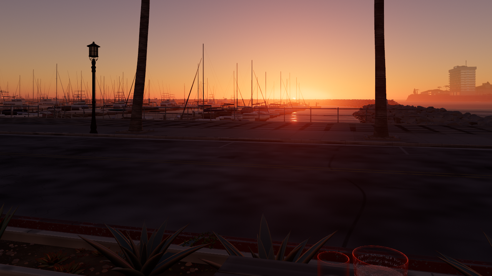
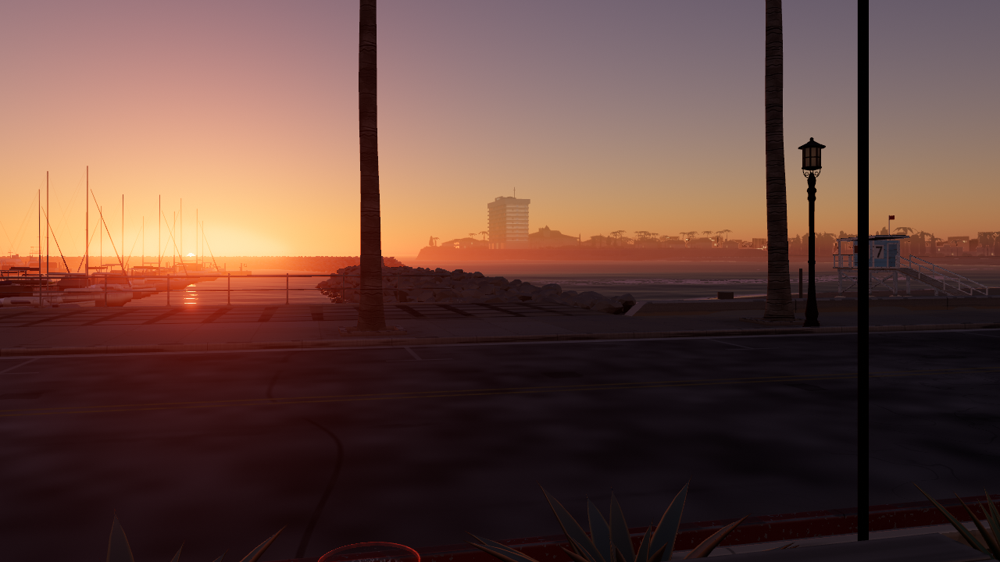
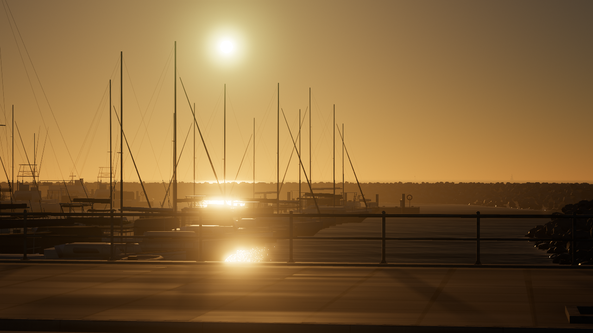
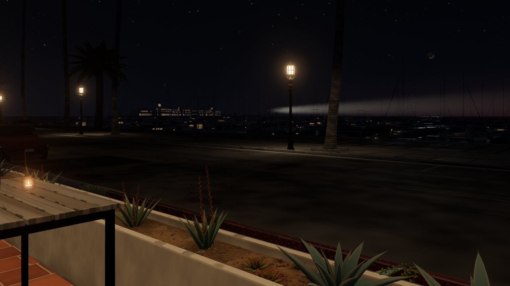

# 夕日マリーナ / Sunset Marina

南カリフォルニア風のマリーナを、テラス席から眺める 3D の夕景です（架空の場所）。
ブラウザで開くだけで動きます。インターネット接続は不要です。

A 3D evening scene of a Southern-California-style marina, seen from a terrace seat (a fictional place).
It runs in your browser — no internet connection required.

| | |
|---|---|
|  |  |
|  | |

## デモ / Demo

ダウンロードせずに、ブラウザですぐ見られます：**https://hex2bkap.github.io/SunsetMarina/**

- 読み込みに少し時間がかかります。波音は ON にしたときに読み込みます
- スマホでも開けますが、PC での表示を想定しています（スマホでは画質「最軽量」から始まります）

Try it in your browser without downloading: https://hex2bkap.github.io/SunsetMarina/
(The wave sound loads only when you turn it ON. Designed for PCs, but it also opens on phones.)

## ダウンロード / Download

[**Releases**](../../releases/latest) から `SunsetMarina_v1.0.0.zip`（約 38MB）をダウンロードしてください。

1. zip を右クリック →「すべて展開」（zip の中から直接開くと動きません）
2. 展開したフォルダの `SunsetMarina.html` をダブルクリック（Edge / Chrome 推奨）

別ファイル `marina_ambience_wave_120min.mp3`（約 143MB）は、2 時間の波音です。プレーヤーでリピート再生して作業用 BGM などにお使いください。

Download `SunsetMarina_v1.0.0.zip` (about 38 MB) from [Releases](../../releases/latest), extract it, and double-click `SunsetMarina.html` (Edge / Chrome recommended).
`marina_ambience_wave_120min.mp3` (about 143 MB) is a separate 2-hour wave-sound file.

## 操作 / Controls

- 視点：4 つ（既定・夕日に寄る・右：浜とホテル・左：マリーナの近景）
- 時間：スライダーと「はじめ／夕焼け／日没／夜」ボタン（17:22〜19:22）。進む速さの切り替えと一時停止
- ドリンク：テーブルのグラスを なし／カクテル／IPA／アイスコーヒー から選べます（選んだものは次回も覚えます）
- 画質：標準・軽量・最軽量（重いときは軽量・最軽量に）
- 波音：ON/OFF（ブラウザの仕様で、最初のクリックかキー操作のあとに鳴り始めます）。音量はお使いの PC 側で調整してください
- 撮影：今の場面を 1920×1080 / 3840×2160 の PNG で保存（操作パネルは写りません）
- `H` キー：操作パネルを隠す／出す（録画のときに便利です。スマホでは「パネルを隠す」「操作」ボタン）

## 推奨環境 / Requirements

WebGL2 が動く GPU を積んだ PC。GTX 1660 Ti クラスで、標準画質・フル HD で滑らかに動きます。
Microsoft Edge / Google Chrome の最新版。Firefox など他のブラウザは動作未確認です。

## 利用条件 / Terms

- 動画・配信・スクリーンショットへのご利用は自由です（収益化も可）。
- クレジット表記は任意ですが、あると嬉しいです。配布元（このページ）へのリンクを添えていただければ幸いです。
- 本ソフトの再配布（転載・ミラー・別サイトへの再アップロード）と、改変物の配布はご遠慮ください。
- 録画した映像を「素材集」として切り売り・販売することもご遠慮ください。
- 本ソフトは現状のまま提供され、動作の保証はありません。ご利用は自己責任でお願いします。
- 場面に登場する名称（看板・店名・船名など）はすべて架空です。実在の人物・団体・店舗とは関係ありません。
- three.js（MIT ライセンス）を同梱しています。[THIRD_PARTY_LICENSES.txt](THIRD_PARTY_LICENSES.txt) をご覧ください。

- Free to use in videos, streams and screenshots (monetization allowed). Credit is optional but appreciated, with a link to this page.
- Please do not redistribute (re-upload / mirror) this software or distribute modified versions, and do not sell recordings as a stock-footage pack.
- Provided "as is", without warranty of any kind. All names in the scene are fictional.
- Includes three.js (MIT License).

---

Created by hex2bkap with Claude (Anthropic).
